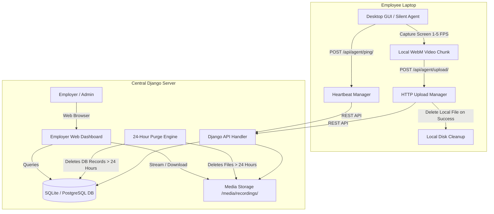

# 🖥️ Employee Monitoring System

[](https://www.python.org/)
[](https://www.djangoproject.com/)
[](https://opencv.org/)
[](#license)

An enterprise-grade, lightweight **Employee Laptop Monitoring and Activity Capture System**. 

The solution features a central **Django Web Management Server** paired with a low-overhead **Desktop Client Software Agent** that records employee screen activity in segmented video clips (up to 1 hour), streams them securely to the server via REST API, and automatically manages storage with a strict **24-Hour Retention & Auto-Purge Engine**.

---

## 📌 Key Features

### 🏢 Central Server (`django_server`)
- **Real-Time Employer Dashboard**: Monitor online employee laptops, active recordings, and total server disk usage via an intuitive web dashboard.
- **Storage Cap Meter (400 MB Limit)**: Built-in storage meter with color-coded status levels (`Green` healthy, `Yellow` warning, `Red` critical) preventing storage overruns.
- **Automated 24-Hour Retention Engine**: Automatically purges recordings and database entries older than 24 hours to enforce storage compliance. Includes cleanup of orphaned files.
- **Device & Employee Management**: Dynamic registration of newly connected laptops and live heartbeat tracking (5-minute ping window).
- **Secure Video Playback & Downloads**: Play `.webm` video chunks directly in the dashboard browser or download them for offline audit.

### 💻 Client Desktop Agent (`employee_client_software`)
- **Ultra-Efficient Screen Recording**: Uses OpenCV, `mss`, and VP8 WebM encoding to record at configurable framerates (1–5 FPS), producing 1-hour screen recording clips at only **~18 MB – 25 MB**.
- **Segmented Recording**: Supports capturing in 5, 15, 30, or **60-minute (1-hour)** video segments.
- **Dual Execution Modes**:
  - **Desktop GUI (`main_gui.py`)**: Admin control app for setting credentials, testing connections, viewing live event logs, and controlling monitoring.
  - **Silent Background Agent (`silent_agent.py`)**: Runs invisibly in the background on employee laptops without UI interference.
- **Zero Local Disk Overhead**: Local video segments are automatically deleted from the laptop as soon as successful upload to the server is confirmed.
- **Executable & Installer Builders**: Includes PyInstaller specs and Inno Setup configuration for generating standalone `.exe` installers.

---

## 🏗️ System Architecture



---

## 📁 Repository Structure

```
Empoylee Monitoring/
├── README.md                      # Primary project documentation
├── django_server/                 # Central Web Portal & REST API Server
│   ├── manage.py                  # Django CLI runner
│   ├── init_db.py                 # Database initialization script
│   ├── seed_demo_data.py          # Demo data generator
│   ├── test_full_system.py        # End-to-end integration test runner
│   ├── employee_monitoring/       # Django project configuration (settings, urls)
│   └── monitoring_app/            # Main application app
│       ├── models.py              # Employee, Device, ScreenRecording models
│       ├── views.py               # Dashboard & Agent API endpoints
│       ├── services.py            # Storage calculation & 24h Purge logic
│       └── templates/             # HTML dashboard UI templates
│
└── employee_client_software/      # Client Laptop Agent
    ├── main_gui.py                # Desktop Control GUI (Tkinter)
    ├── silent_agent.py            # Invisible background agent service
    ├── agent_engine.py            # Screen capture & REST API client engine
    ├── config.json                # Agent configuration file
    ├── requirements.txt           # Python dependencies for client
    ├── build_exe.py               # PyInstaller standalone executable builder
    ├── build_silent_installer.py  # Inno Setup silent installer builder
    ├── EmployeeMonitorSilent.spec # PyInstaller spec file
    └── installer_script.iss       # Inno Setup configuration
```

---

## 🚀 Quick Start Guide

### 1. Setting Up the Central Server (`django_server`)

#### Prerequisites
- Python 3.8 or higher
- `pip` package manager

#### Step-by-Step Server Setup
1. **Navigate to the server directory**:
   ```bash
   cd django_server
   ```

2. **Install dependencies**:
   ```bash
   pip install django
   ```

3. **Initialize the database & create admin account**:
   ```bash
   python init_db.py
   ```
   *(Default Employer Admin Credentials: Username: `admin` | Password: `admin`)*

4. *(Optional)* **Seed demo data for testing**:
   ```bash
   python seed_demo_data.py
   ```

5. **Start the Django Development Server**:
   ```bash
   python manage.py runserver 0.0.0.0:8000
   ```

6. **Access the Employer Dashboard**:
   Open `http://localhost:8000` or `http://<SERVER-IP>:8000` in your web browser and login.

---

### 2. Setting Up the Employee Desktop Client (`employee_client_software`)

#### Installation
1. **Navigate to the client directory**:
   ```bash
   cd employee_client_software
   ```

2. **Install client requirements**:
   ```bash
   pip install -r requirements.txt
   ```

#### Mode A: Desktop Control GUI (`main_gui.py`)
Run the interactive graphical interface to configure and launch monitoring:
```bash
python main_gui.py
```
- Set **Django Server URL** (e.g., `http://192.168.1.50:8000`).
- Set **Employee Code** (e.g., `EMP001`).
- Choose **Segment Duration** (e.g., `60 Minutes (1 Hour)`).
- Click **Test Connection** to verify API communication.
- Click **Start Monitoring** to begin capturing and transmitting screen recordings.

#### Mode B: Silent Background Agent (`silent_agent.py`)
For headless or background operation on employee laptops:
```bash
python silent_agent.py
```

---

## 🛠️ Building Executable & Installer

To deploy the client software onto corporate laptops without installing Python manually:

1. **Build Standalone `.exe`**:
   ```bash
   python build_exe.py
   ```
   This generates a standalone binary in `employee_client_software/dist/`.

2. **Build Silent Windows Installer**:
   Ensure [Inno Setup](https://jrsoftware.org/isinfo.php) is installed, then run:
   ```bash
   python build_silent_installer.py
   ```

---

## 📡 REST API Reference

The Django server exposes the following public endpoints for client agents:

### 1. Register Laptop Device
- **Endpoint**: `POST /api/agent/register/`
- **Payload**:
  ```json
  {
    "employee_code": "EMP001",
    "employee_name": "John Doe",
    "employee_email": "john@company.com",
    "hostname": "JOHN-LAPTOP",
    "os_info": "Windows 11 Enterprise"
  }
  ```
- **Response**: `200 OK`

### 2. Heartbeat Ping
- **Endpoint**: `POST /api/agent/ping/`
- **Payload**:
  ```json
  {
    "employee_code": "EMP001",
    "hostname": "JOHN-LAPTOP"
  }
  ```
- **Response**: `200 OK` (`{"status": "pong", "is_online": true}`)

### 3. Upload Video Segment
- **Endpoint**: `POST /api/agent/upload/`
- **Form Data**:
  - `employee_code`: `EMP001`
  - `duration_seconds`: `3600`
  - `recorded_at`: `2026-09-02T09:00:00`
  - `video_chunk`: `[File]`
- **Response**: `200 OK` (`{"status": "uploaded", "file_size_mb": 22.4, ...}`)

---

## 🧪 Integration Testing

The project includes an end-to-end integration test verifying auth protection, device registration API, 1-hour WebM uploads, storage limits, and 24-hour auto-purge functionality.

Run the test suite from the `django_server` directory:
```bash
cd django_server
python test_full_system.py
```

Expected output:
```text
=== INTEGRATION TEST: SEPARATE DJANGO SERVER & DESKTOP AGENT API ===
[OK] Unauthenticated access properly redirected to /login/
[OK] Employer Login with admin / admin succeeded!
[OK] Dashboard accessible after employer login!
[OK] Desktop App Registration API (/api/agent/register/) passed!
[OK] 1-Hour Video Segment Upload API (/api/agent/upload/) passed!
[OK] Display Duration verified: 1h 0m
[OK] Expiration set to 24 hours from upload
[OK] 24-Hour Auto-Purge Engine verified! File and DB entry purged!
ALL SEPARATE SERVER & DESKTOP CLIENT TESTS PASSED!
```

---

## ⚖️ Legal & Privacy Disclaimer

This software is designed strictly for authorized employee activity monitoring and compliance auditing on corporate-owned devices. Ensure full compliance with local employment laws, workplace privacy regulations, and employee notification policies prior to deployment.

---

## 📄 License

Distributed under the MIT License. See `LICENSE` for more information.
